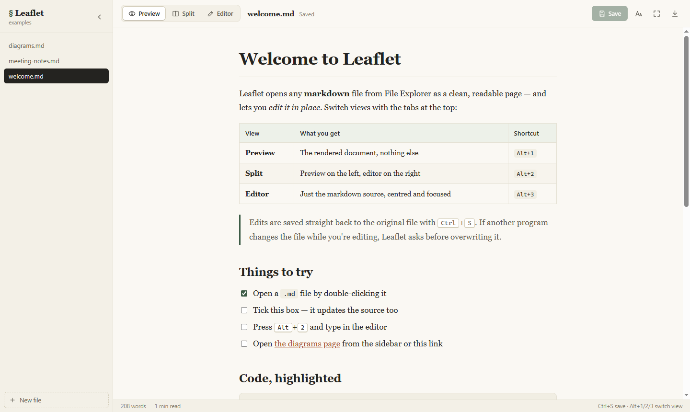
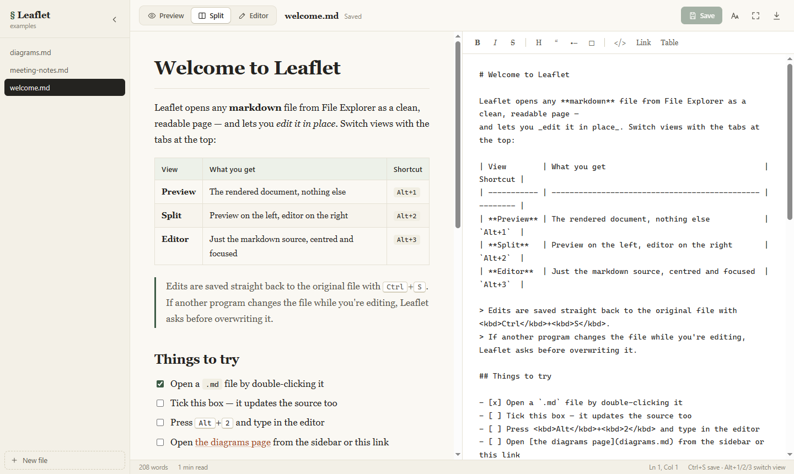
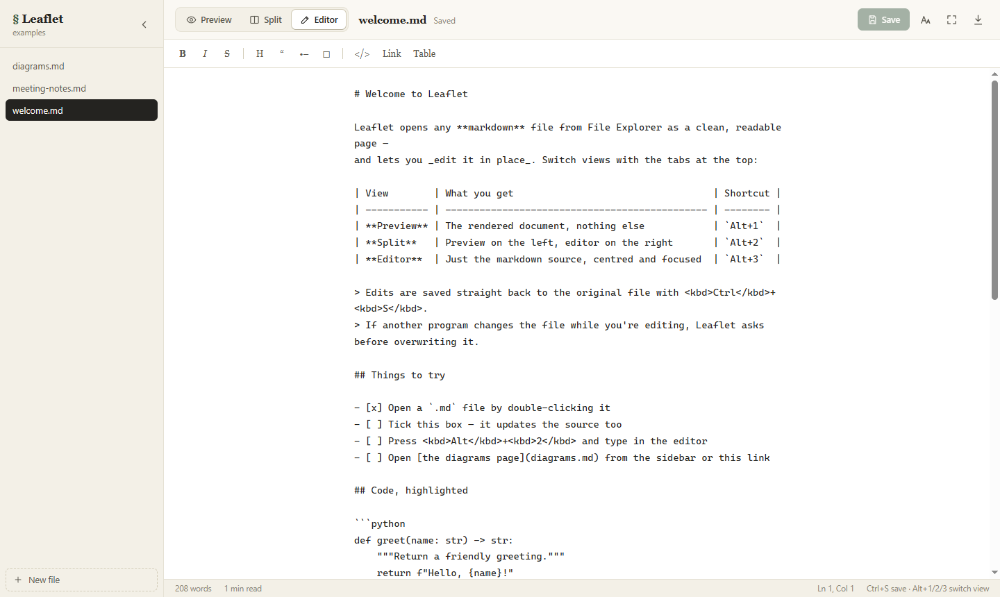
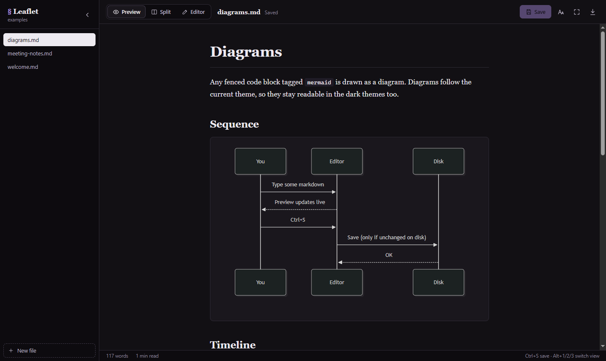
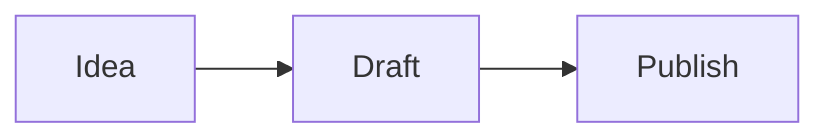
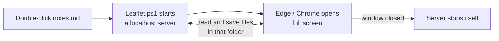

# § Leaflet

**Double-click any Markdown file in Windows and read it like a page — or edit it right there.**

Leaflet is a small, fully offline Markdown viewer **and editor** for Windows. It opens
`.md` files from File Explorer in a clean full-screen window, with live preview, Mermaid
diagrams, syntax-highlighted code and four reading themes. Edits save straight back to
the original file.

No installer, no Electron, no account, nothing uploaded. Just PowerShell (built into
Windows) and the browser you already have.



---

## Contents

- [Features](#features)
- [Three views](#three-views)
- [Quick start](#quick-start)
- [Using Leaflet](#using-leaflet)
- [Options](#options)
- [How it works](#how-it-works)
- [Project structure](#project-structure)
- [Security](#security)
- [Troubleshooting](#troubleshooting)
- [Uninstall](#uninstall)
- [Development](#development)
- [Credits & license](#credits--license)

## Features

- **Preview, Split and Editor views** — read, write, or both side by side.
- **Saves to the original file** with <kbd>Ctrl</kbd>+<kbd>S</kbd>, keeping its line endings
  (CRLF/LF) and encoding, so saving doesn't turn every line into a git diff.
- **Safe saving** — if another program changed the file since you opened it, Leaflet asks
  before overwriting. Files edited elsewhere reload automatically.
- **Opens full screen** in a clean app window (Edge or Chrome) — no tabs, no address bar —
  with a **✕ Close** button at the top-right.
- **One-command install** with `npm install -g leaflet-md-opener`.
- **GitHub-flavoured Markdown** — tables, task lists, strikethrough, nested lists,
  reference links, images, and raw HTML (sanitised).
- **Mermaid diagrams** — flowcharts, sequence, gantt, pie… drawn live, in the theme's colours.
- **Syntax highlighting** with a copy button on every code block.
- **Clickable task lists** — tick a checkbox in the preview and the source updates.
- **Sidebar of every Markdown file in the folder**, with a dot on files that have unsaved
  changes. Links between `.md` files open inside Leaflet.
- **Scroll sync** in Split view, matched block by block (not just by percentage), so a tall
  diagram doesn't throw it off.
- **Editor helpers** — bold, italic, links, lists that continue on <kbd>Enter</kbd>,
  <kbd>Tab</kbd> to indent, and a formatting bar.
- **Four themes** (Paper, Sepia, Slate, Midnight), adjustable line width and text size —
  remembered between sessions.
- **Export to PDF** via the print dialog, in the current theme.
- **100% offline.** Every library is bundled in `src/web/vendor`.

## Three views

Switch with the tabs at the top, or <kbd>Alt</kbd>+<kbd>1</kbd> / <kbd>2</kbd> / <kbd>3</kbd>.
Every file opens in **Preview** first.

| Preview | Split | Editor |
| :-: | :-: | :-: |
|  |  |  |
| The rendered document only | Preview **left**, editor **right**, scroll-synced | Just the source, centred |

Drag the divider in Split view to resize it (double-click it to reset to 50/50).

Dark themes recolour diagrams and code too:



## Quick start

**Requirements:** Windows 10 or 11. PowerShell 5.1 and Microsoft Edge come with Windows.
(Chrome works too; with any other browser Leaflet opens in a normal tab.)

### Option A — npm (one command)

If you have [Node.js](https://nodejs.org) installed:

```powershell
npm install -g leaflet-md-opener
```

That's it. The install:

1. copies Leaflet onto your machine and adds a `leaflet-md` command;
2. registers Leaflet for `.md` and `.markdown` files (for your user only, no admin rights);
3. opens Windows' **"How do you want to open this file?"** box — pick **Leaflet**, tick
   **Always use this app**, click **OK**.

> **Why the last click?** Windows deliberately blocks every program from making itself the
> default app, so the final "Always" has to be yours. Leaflet just opens the box for you.

From then on, double-clicking any Markdown file opens it in Leaflet, full screen. You can
also open files from a terminal:

```powershell
leaflet-md notes.md                  # open a file (full screen)
leaflet-md notes.md --window tab     # ...or in a browser tab
leaflet-md install --window maximized  # change how double-click opens files
leaflet-md --help
```

Set `LEAFLET_NO_PICKER=1` before installing to skip the dialog, or `LEAFLET_NO_REGISTER=1`
to skip registration entirely (run `leaflet-md install` later).

### Option B — download or clone (no Node.js needed)

#### 1. Download


Either clone it:

```powershell
git clone https://github.com/<your-username>/leaflet-md-opener.git C:\Tools\Leaflet
```

…or click **Code → Download ZIP** on GitHub and unzip it somewhere permanent, such as
`C:\Tools\Leaflet`. Don't leave it in Downloads — Windows runs it from wherever it is.

> **Downloaded the ZIP?** Windows marks downloaded scripts as untrusted. Unblock them once,
> from PowerShell inside the folder:
>
> ```powershell
> Get-ChildItem -Recurse | Unblock-File
> ```

#### 2. Register it for `.md` files

Open PowerShell in the Leaflet folder and run:

```powershell
powershell -ExecutionPolicy Bypass -File .\scripts\install.ps1 -ShowPicker
```

This adds Leaflet to the **Open with** menu for `.md` and `.markdown` files — for your user
only, with no admin rights and nothing system-wide — and opens Windows' app picker.

#### 3. Make it the default

In the box that opens, pick **Leaflet**, tick **Always use this app to open .md files**,
then **OK**. (Missed it? Right-click any `.md` file → **Open with** → **Choose another app**.)

Done. Double-clicking a Markdown file now opens it in Leaflet, full screen.

<details>
<summary><b>Prefer not to run the install script?</b></summary>

Point Windows at the launcher directly instead:

1. Right-click any `.md` file → **Open with** → **Choose another app**.
2. **More apps** → **Look for another app on this PC**.
3. Select `Leaflet.bat` in the Leaflet folder.
4. Tick **Always use this app**, then **OK**.

It works the same way; a console window may flash for a moment when a file opens.
</details>

### Try it

Open `examples\welcome.md` — a short tour of everything Leaflet renders.

## Using Leaflet

### Keyboard shortcuts

| Shortcut | Action |
| --- | --- |
| <kbd>Ctrl</kbd>+<kbd>S</kbd> | Save |
| <kbd>Alt</kbd>+<kbd>1</kbd> / <kbd>2</kbd> / <kbd>3</kbd> | Preview / Split / Editor |
| <kbd>F11</kbd> | Leave or enter full screen |
| <kbd>Ctrl</kbd>+<kbd>P</kbd> | Print / export to PDF |
| <kbd>Ctrl</kbd>+<kbd>\\</kbd> | Show / hide the file sidebar |
| <kbd>Ctrl</kbd>+<kbd>B</kbd> / <kbd>I</kbd> / <kbd>E</kbd> | Bold / italic / inline code (editor) |
| <kbd>Ctrl</kbd>+<kbd>K</kbd> | Insert a link (editor) |
| <kbd>Tab</kbd> / <kbd>Shift</kbd>+<kbd>Tab</kbd> | Indent / outdent lines (editor) |
| <kbd>Enter</kbd> on a list item | Continue the list (on an empty item: end it) |
| <kbd>Ctrl</kbd>+<kbd>Z</kbd> / <kbd>Ctrl</kbd>+<kbd>Y</kbd> | Undo / redo |

### A quick example

Type this in the editor:

````markdown
## Shopping list

- [x] Coffee
- [ ] Bread


````

…and the preview shows a real checklist and a drawn flowchart as you type.

### Saving and changes on disk

- The toolbar shows **Unsaved changes**, and the file gets a dot in the sidebar, until you save.
- You can switch files in the sidebar without losing unsaved edits.
- Closing the window with unsaved edits asks you first.
- If another program changes the file:
  - **with no unsaved edits** — Leaflet reloads it automatically;
  - **while you're editing** — a banner lets you keep your version or load theirs.
    Saving never silently overwrites someone else's change.

### Display settings

The **Aa** button sets the theme, line width and text size. They are remembered in
`%APPDATA%\Leaflet\settings.json`. Until you pick a theme, Leaflet follows Windows'
light/dark setting.

## Options

To change how files open from Explorer, re-run the install script with `-Window`:

```powershell
# Maximized app window instead of full screen
powershell -ExecutionPolicy Bypass -File .\scripts\install.ps1 -Window maximized

# A normal tab in your default browser
powershell -ExecutionPolicy Bypass -File .\scripts\install.ps1 -Window tab
```

Or run Leaflet by hand:

```powershell
.\src\Leaflet.ps1 -Path C:\notes\todo.md                    # full screen (default)
.\src\Leaflet.ps1 -Path C:\notes\todo.md -Window maximized
.\src\Leaflet.ps1 -Path C:\notes                            # open a folder
.\src\Leaflet.ps1 -Path C:\notes\todo.md -NoBrowser         # just print the URL
```

| Option | Default | Meaning |
| --- | --- | --- |
| `-Window` | `fullscreen` | `fullscreen`, `maximized`, or `tab` |
| `-IdleMinutes` | `30` | Stop the background helper after this long with no activity |
| `-Port` | random | Port to listen on (localhost only) |
| `-NoBrowser` | off | Print the URL instead of opening a window |

## How it works

A web page opened straight from disk can't save files, so Leaflet runs a tiny helper web
server, written in PowerShell, for as long as the window is open.



- The server listens on `localhost` only — nothing on your network can reach it.
- It serves the app from `src/web`, plus the files in the opened file's folder (so relative
  images in your Markdown work).
- It stops itself about 20 seconds after you close the window, or after 30 minutes idle.
- Full screen works by starting Edge/Chrome with `--app --start-fullscreen` and a separate
  Leaflet browser profile (in `%LOCALAPPDATA%\Leaflet`), so the window opens full screen even
  while your normal browser is already running. Your normal browser profile is never touched.

## Project structure

```text
leaflet-md-opener/
├── Leaflet.bat              # launcher - what "Open with" can point at
├── package.json             # npm package: `npm install -g leaflet-md-opener`
├── bin/
│   ├── leaflet-md.js        # the `leaflet-md` command
│   └── postinstall.js       # registers .md files after a global npm install
├── src/
│   ├── Leaflet.ps1          # local server + browser launcher
│   ├── Leaflet.Helpers.ps1  # pure helpers (paths, encodings) - unit-tested
│   └── web/                 # the app itself
│       ├── index.html
│       ├── icon.svg
│       ├── css/leaflet.css  # all styling; themes are CSS variables
│       ├── js/
│       │   ├── app.js         # wires everything together
│       │   ├── api.js         # talks to the local server
│       │   ├── render.js      # Markdown -> preview, diagrams, code blocks
│       │   ├── sanitize.js    # allow-list HTML sanitiser
│       │   ├── editor.js      # editor shortcuts and formatting
│       │   ├── scroll-sync.js # Split-view scroll matching
│       │   └── ui.js          # toasts, banners, small helpers
│       └── vendor/          # marked, highlight.js, mermaid (bundled, offline)
├── scripts/
│   ├── install.ps1          # add Leaflet to "Open with" (per user)
│   └── uninstall.ps1
├── tests/
│   └── Leaflet.Helpers.Tests.ps1
├── examples/                # sample documents - start with welcome.md
└── docs/images/             # screenshots used in this README
```

## Security

Leaflet can write files, so it is careful about who can ask it to:

- **Localhost only**, on a random port, behind a random 48-character token in every URL.
  Other websites open in your browser can't guess it, so they can't read or change files.
- **Writes need a custom header** (`X-Leaflet: 1`), which a cross-site form or image can't
  send, and the `Host` header must be `localhost` (this blocks DNS-rebinding tricks).
- **Only `.md`/`.markdown` files directly inside the opened folder can be written.** Path
  traversal (`..\`), other folders and other file types are refused.
- **Markdown is sanitised.** Raw HTML in a document you downloaded can't run scripts: an
  allow-list sanitiser strips scripts, event handlers and `javascript:` links, and a strict
  Content-Security-Policy blocks inline script as a second layer.
- **Only images, audio, video and PDFs from the folder are served** (for embedding), never
  `.html`, `.svg` or `.js` — those could otherwise run on Leaflet's own origin.
- **Files that aren't UTF-8 open read-only**, so saving can never garble their characters.
- **Saves are atomic** (temp file, then swap), so a crash never leaves a half-written file.

Found a problem? Please open an issue.

## Troubleshooting

<details>
<summary><b>Nothing happens when I open a file</b></summary>

Check `%TEMP%\leaflet.log` for errors. If you downloaded the ZIP, make sure you ran
`Get-ChildItem -Recurse | Unblock-File` in the folder. If you moved the Leaflet folder
after installing, run `scripts\install.ps1` again.
</details>

<details>
<summary><b>It opens in a normal browser tab, not full screen</b></summary>

Full screen needs Microsoft Edge or Google Chrome in their standard install location. With
any other browser Leaflet falls back to a tab — press <kbd>F11</kbd> there.
</details>

<details>
<summary><b>"Leaflet's background helper has stopped"</b></summary>

The helper stops after 30 minutes with no activity (for example if the PC slept). Your text
is still in the window: click **Download a copy**, then reopen the file. You can raise the
limit with `-IdleMinutes`.
</details>

<details>
<summary><b>How do I get out of full screen?</b></summary>

Press <kbd>F11</kbd>. To quit, click the **✕** at the top-right (or <kbd>Alt</kbd>+<kbd>F4</kbd>).
</details>

<details>
<summary><b>Double-clicking still opens another app after <code>npm install</code></b></summary>

The "Always use this app" step is Windows' and can't be automated. Run `leaflet-md install`
to bring the picker back, choose **Leaflet** and tick **Always**.
</details>

## Uninstall

**Installed with npm** — remove the registration *first*, then the package (npm no longer
runs uninstall hooks, so it can't do the first step for you):

```powershell
leaflet-md uninstall              # add --remove-data to also delete settings
npm uninstall -g leaflet-md-opener
```

**Downloaded or cloned:**

```powershell
powershell -ExecutionPolicy Bypass -File .\scripts\uninstall.ps1             # remove from Open with
powershell -ExecutionPolicy Bypass -File .\scripts\uninstall.ps1 -RemoveData # also delete settings
```

Then delete the folder. Uninstalling never touches your Markdown files.

## Development

There's no build step — edit the files in `src/web` and reopen a document.

```powershell
# Run the helper tests
powershell -ExecutionPolicy Bypass -File .\tests\Leaflet.Helpers.Tests.ps1

# Start a server without a window, then open the printed URL in any browser
.\src\Leaflet.ps1 -Path .\examples\welcome.md -NoBrowser
```

To publish a new version to npm (set the `<your-username>` URLs in `package.json` first):

```powershell
npm version patch     # or minor / major
npm publish
```

Keep the `.ps1` files ASCII-only: Windows PowerShell 5.1 reads a script without a BOM in the
system code page, so a stray `—` breaks it.

## Credits & license

Leaflet is released under the [MIT License](LICENSE).

Bundled libraries (see [THIRD_PARTY_NOTICES.md](THIRD_PARTY_NOTICES.md)):
[marked](https://github.com/markedjs/marked) (MIT),
[highlight.js](https://github.com/highlightjs/highlight.js) (BSD-3-Clause),
[Mermaid](https://github.com/mermaid-js/mermaid) (MIT).
