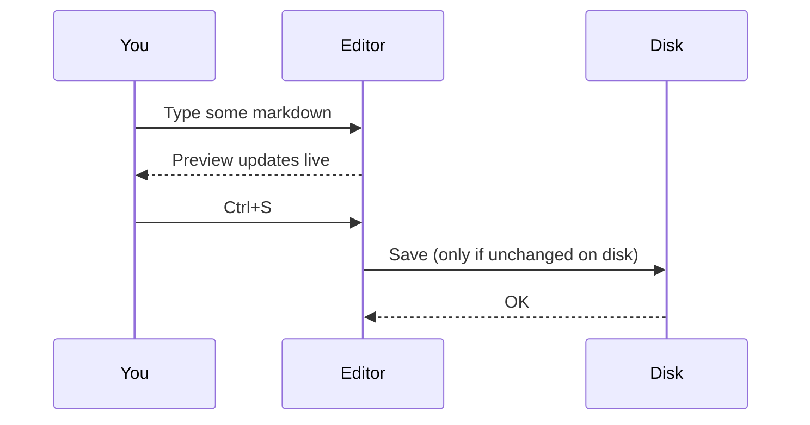
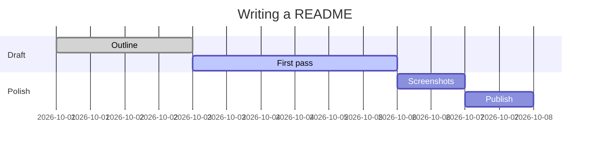
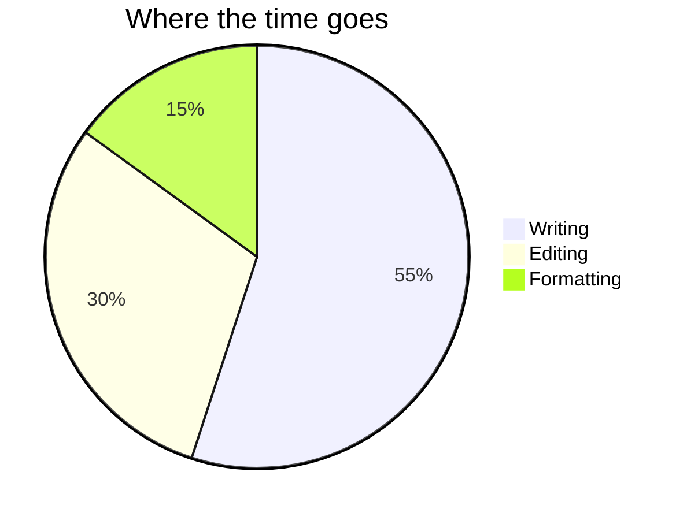

# Diagrams

Any fenced code block tagged `mermaid` is drawn as a diagram. Diagrams follow the
current theme, so they stay readable in the dark themes too.

## Sequence

## Timeline

## Pie

Back to [the welcome page](welcome.md#things-to-try).
