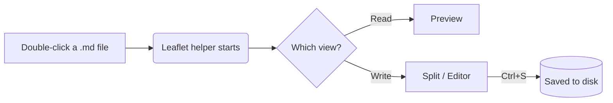

# Welcome to Leaflet

Leaflet opens any **markdown** file from File Explorer as a clean, readable page —
and lets you _edit it in place_. Switch views with the tabs at the top:

| View        | What you get                                   | Shortcut |
| ----------- | ---------------------------------------------- | -------- |
| **Preview** | The rendered document, nothing else            | `Alt+1`  |
| **Split**   | Preview on the left, editor on the right       | `Alt+2`  |
| **Editor**  | Just the markdown source, centred and focused  | `Alt+3`  |

> Edits are saved straight back to the original file with <kbd>Ctrl</kbd>+<kbd>S</kbd>.
> If another program changes the file while you're editing, Leaflet asks before overwriting it.

## Things to try

- [x] Open a `.md` file by double-clicking it
- [ ] Tick this box — it updates the source too
- [ ] Press <kbd>Alt</kbd>+<kbd>2</kbd> and type in the editor
- [ ] Open [the diagrams page](diagrams.md) from the sidebar or this link

## Code, highlighted

```python
def greet(name: str) -> str:
    """Return a friendly greeting."""
    return f"Hello, {name}!"

print(greet("Leaflet"))
```

```powershell
Get-ChildItem *.md | ForEach-Object { $_.Name }
```

## A diagram, rendered



---

Everything runs **offline** on your own machine. Nothing is uploaded anywhere.
